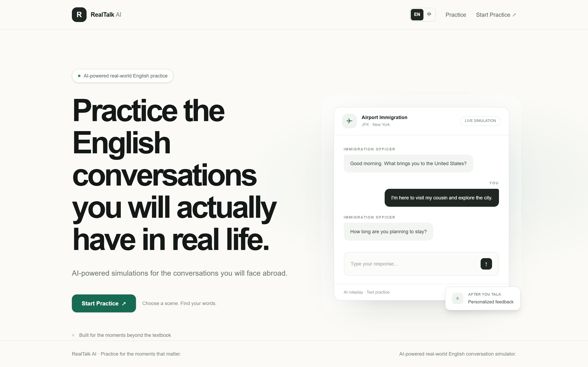
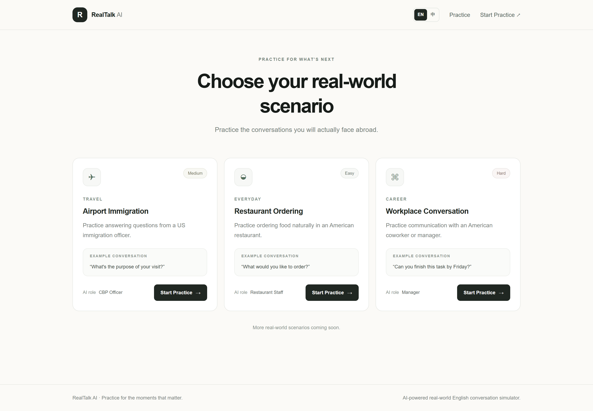
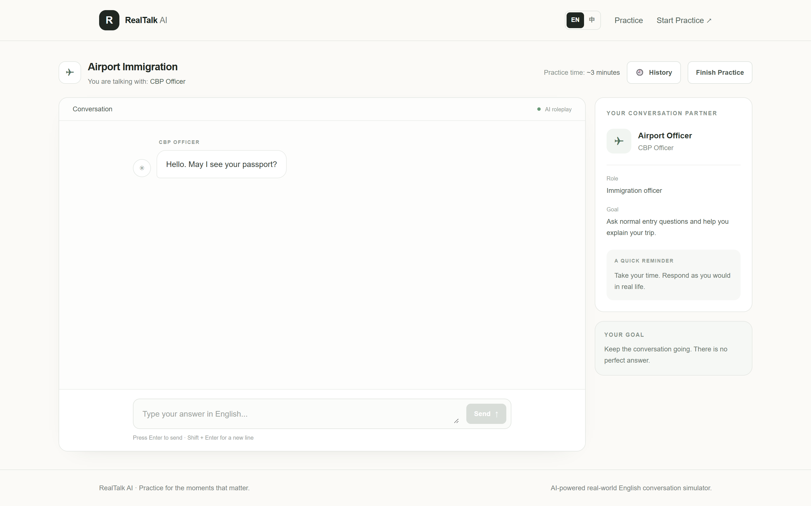
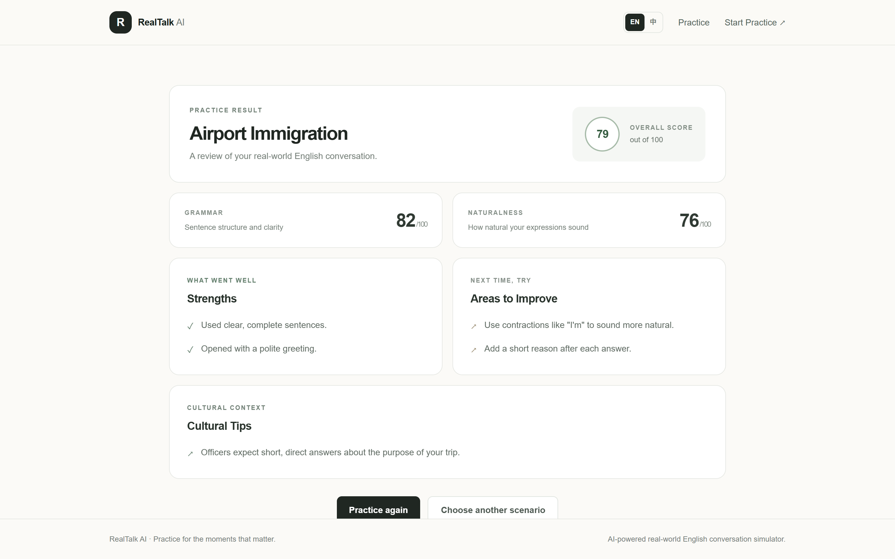

# RealTalk AI — Real-world English Conversation Practice

**Practice the English conversations you will actually have in real life.**

RealTalk AI is an AI-powered web application that simulates the high-stakes everyday conversations people face abroad — airport immigration, restaurant ordering, and workplace communication. Users role-play with realistic AI characters and receive instant, personalized feedback on grammar, naturalness, and cultural context.

🌐 **Live demo:** [https://www.jeromepark.top](https://www.jeromepark.top)


---

## Screenshots

| Home | Scenarios |
| :---: | :---: |
|  |  |
| **Conversation** | **Feedback report** |
|  |  |

---

## Features

- 🎭 **Scenario-based role-play** — Guided simulations for airport immigration, restaurant ordering, and workplace conversations, each with a defined AI persona and goal.
- 🤖 **Context-aware AI replies** — Multi-turn conversations powered by the DeepSeek Chat API (OpenAI-compatible), with the full message history sent on every turn.
- 📝 **Instant personalized feedback** — After a session, the app produces grammar and naturalness scores, strengths, areas to improve, and cultural tips.
- 🌐 **Bilingual UI (English / 中文)** — A dependency-free, context-based internationalization layer. Visitors switch languages with one click, and the choice is remembered locally. Practice content itself stays in English.
- 💾 **Local-first chat history** — Conversations auto-save to the browser's `localStorage`. Users can reopen, continue, or delete past sessions with **zero server-side storage and no database**.
- 📱 **Responsive, app-like layout** — A fixed app shell keeps the header and message input always visible; only the message stream scrolls, on both desktop and mobile.
- 🛡️ **Robust API layer** — Server-side request validation, typed error responses, input limits, and graceful failure with retry.
- 🪶 **Low-resource self-hosting** — Ships as a Next.js standalone bundle and runs comfortably on a single-core, ~512 MB VPS behind Nginx and Cloudflare.

## Tech Stack

| Layer | Choice |
| --- | --- |
| Framework | Next.js 16 (App Router, Turbopack) |
| UI | React 19, TypeScript, Tailwind CSS v4 |
| AI | DeepSeek Chat API (`deepseek-chat`), OpenAI-compatible chat completions |
| State | React hooks, React Context (i18n) |
| Persistence | Browser `localStorage` (history, feedback, language) |
| Deployment | Node.js standalone output, systemd, Nginx reverse proxy, Cloudflare CDN |
| Privacy | No cookies, no tracking database; optional Cloudflare Web Analytics |

## How It Works

1. **Choose a scenario** — Pick the real-world situation you want to rehearse.
2. **Talk with the AI** — Hold a natural text conversation with the AI character. Messages are saved locally as you go.
3. **Get feedback** — Finish the session to receive scores and concrete suggestions you can apply next time.

## Project Structure

```
src/
├── app/
│   ├── api/
│   │   ├── chat/route.ts          # AI conversation endpoint
│   │   └── feedback/route.ts      # Post-practice feedback endpoint
│   ├── conversation/[sessionId]/  # Role-play page
│   ├── feedback/[sessionId]/      # Feedback report page
│   ├── scenarios/                 # Scenario catalog
│   ├── layout.tsx                 # Root layout + language provider
│   └── page.tsx                   # Landing page
├── components/
│   ├── conversation/              # Chat window, input, bubbles, history drawer
│   ├── feedback/                  # Feedback report UI
│   ├── home/                      # Landing sections
│   ├── layout/                    # Header, footer, page shell
│   └── scenarios/                 # Scenario cards
├── data/                          # Scenario definitions and opening lines
└── lib/
    ├── ai/                        # DeepSeek client, prompts, feedback analyzer, validation
    ├── history/                   # localStorage-backed chat history
    └── i18n/                      # Lightweight EN/中文 dictionaries and provider
```

## Engineering Highlights

- **Zero-dependency i18n and storage.** Rather than pulling in heavy libraries, the app ships a small context-based translator and a versioned `localStorage` store. This keeps the JavaScript bundle lean and removes any server cost for user data.
- **Privacy- and cost-conscious architecture.** Conversation history never leaves the browser, so the server stays stateless and inexpensive to run — an important constraint for the 512 MB VPS it is hosted on.
- **Production self-hosting.** The project builds to a self-contained standalone bundle, runs under `systemd` with a capped memory limit, and is served by Nginx as a reverse proxy (sharing the host with other services), with Cloudflare in front for CDN and TLS.
- **Prompt design.** The chat and feedback flows use structured system prompts and a validated JSON feedback schema to keep AI output consistent and safe to render.

## Getting Started

**Prerequisites:** Node.js 18+ (developed on Node 22) and a DeepSeek API key.

```bash
# 1. Install dependencies
npm install        # or: pnpm install

# 2. Configure environment
cp .env.example .env.local
#   then put your key in .env.local:
#   DEEPSEEK_API_KEY=sk-xxxxxxxx
#   DEEPSEEK_MODEL=deepseek-chat   # optional

# 3. Run the dev server
npm run dev
```

Open [http://localhost:3000](http://localhost:3000).

### Other scripts

```bash
npm run build    # production build
npm run start    # serve the production build
npm run lint     # run ESLint
```

## Deployment

The app is deployed as a Next.js **standalone** bundle:

1. `npm run build` produces a self-contained output in `.next/standalone`.
2. Copy the bundle (plus `.next/static`) to your server and run `node server.js` (the included `systemd` unit manages restarts and memory).
3. Put Nginx (or any reverse proxy) in front of the Node port, and point your domain at it.
4. Cloudflare provides CDN caching and TLS; the same host can run other services on different paths/ports.

Set `DEEPSEEK_API_KEY` in the server environment (for example via an environment file loaded by `systemd`).

## License

Released under the [MIT License](LICENSE).

## About

Built by **南 (Jerome)** to close the gap between textbook English and the real conversations people face when living and working abroad.
